<div align="center">

# QRIS Web Merchant · Front-End

**Portal merchant QRIS Bank SulutGo: admin merchant mengelola outlet & terminal, terminal (kasir) membuat QR pembayaran.**


</div>

> Satu portal untuk dua jenis user: admin merchant melihat outlet, laporan, dan mengatur terminal; terminal menampilkan QR pembayaran ke pelanggan.

<p align="center"></p>

| | |
|---|---|
| 🏪 **Merchant & Outlet** | Data merchant, daftar outlet, dan binding terminal |
| 📊 **Report** | Histori transaksi dengan total jumlah & nominal per outlet |
| 🧾 **Terminal & QR** | Halaman kasir untuk generate QR dinamis, plus layar QR untuk pelanggan |
| 🔐 **Browser Key** | Terminal terikat ke browser lewat key Web Crypto (IndexedDB) |
| 🐳 **Satu Image untuk Semua Env** | URL backend diisi saat runtime lewat env `APP_URL` |

Back-End: [**qris-web-merchant-api**](https://gitea.dev.bsg.id/michio/qris-merchant-public-api)

## 1. DEVELOPMENT REQUIREMENTS
- [**React 19**](https://react.dev)
- [**Vite 7**](https://vite.dev)
- [**NodeJs**](https://nodejs.org) (image memakai Node 20)
- [**qris-web-merchant-api**](https://gitea.dev.bsg.id/michio/qris-merchant-public-api) (Back-End)

## 2. LOCAL INSTALLATION STEPS
- Download repo **qris-web-merchant-metronic**
- Buat `.env` berisi URL backend:
    ```
    VITE_APP_API_URL=http://localhost:30020
    VITE_APP_ENV=local
    ```
- Jalankan perintah berikut untuk menginstall package pada **package.json**:
    ```bash
    npm install --legacy-peer-deps
    ```
- Jalankan perintah berikut untuk menjalankan aplikasi secara local (`http://localhost:5173`):
    ```bash
    npm run dev
    ```

- Jalankan perintah berikut untuk melakukan *manual build*:
    ```bash
    npm run build
    ```

Backend lokal dijalankan dari repo **qris-web-merchant-api** (`docker-compose.local.yaml`), yang juga menjalankan image FE ini di `http://localhost:30010`.

## 3. STRUKTUR APLIKASI
Hanya file inti aplikasi. Layout bawaan template Metronic lainnya (`pages/metronic-layouts/layout-*`, `components/layouts/layout-*`) tidak dipakai di router.

```
qris-web-merchant-metronic/
├── src/
│   ├── main.jsx, App.jsx              # Bootstrap React
│   ├── config/runtime.js              # API_URL & APP_ENV dari meta tag, fallback ke VITE_APP_*
│   ├── routing/
│   │   └── app-routing-setup.jsx      # Daftar route + guard session (lihat 3.1)
│   ├── services/
│   │   ├── AxiosInstance.js           # Axios ke `${API_URL}/api/v1/mrchadmin`, toast per endpoint
│   │   ├── AuthService.js             # Login, logout, validasi session
│   │   ├── CryptoService.js           # Browser key terminal (Web Crypto + IndexedDB)
│   │   ├── QRService.js               # Render QR
│   │   └── ImagePrintService.js       # Cetak gambar QR
│   ├── context/AppDataContext.jsx     # Data merchant/outlet bersama
│   ├── pages/
│   │   ├── auth/login.jsx             # /login
│   │   └── metronic-layouts/
│   │       ├── layout-1/              # Admin: merchant.jsx, outlets.jsx, merchant-report.jsx
│   │       └── layout-32/             # Terminal: terminal-page.jsx, terminal-qr-display.jsx
│   └── components/layouts/
│       ├── layout-1/                  # Kerangka halaman admin
│       └── layout-32/                 # Kerangka halaman terminal
├── index.html                         # Meta `app_url` & `app_env` disisipkan saat build image
├── nginx.conf                         # SSI: mengisi meta dari env APP_URL & APP_ENV saat runtime
├── Dockerfile                         # Build Vite -> image nginx
├── changelogs.txt                     # Ditulis otomatis oleh deploy.sh
└── deploy.sh                          # Versioning, git tag, build & push image
```

**APP_URL**: URL backend tidak di-hardcode saat build. Container membaca env `APP_URL` dan `APP_ENV`, nginx (SSI) menuliskannya ke meta `app_url` / `app_env` pada `index.html`, lalu dibaca oleh `src/config/runtime.js`. Satu image bisa dipakai di semua environment.

### 3.1 Route
| Route | User | Halaman |
|-------|------|---------|
| `/login` | Semua | Login admin & terminal |
| `/merchant` | Admin | Data merchant |
| `/outlet` | Admin | Daftar outlet & terminal |
| `/report` | Admin | Histori transaksi |
| `/terminal/outlet`, `/terminal/pembayaran` | Terminal | Generate QR pembayaran |
| `/terminal/qr-display` | Terminal | Layar QR untuk pelanggan |

Route hanya untuk tampilan. Hak akses sebenarnya dicek di backend.

## 4. DEPLOYMENT
- Jalankan perintah berikut untuk menjalankan proses Deployment:

    ```bash
    ./deploy.sh
    ```

    **JALANKAN SCRIPT SETELAH SEMUA PERUBAHAN DI-COMMIT.** Script akan langsung berhenti (exit 1) dan menampilkan daftar file jika masih ada perubahan yang belum di-commit maupun file *untracked*. Gunakan `git stash` untuk menyimpan sementara pekerjaan yang belum selesai, lalu `git stash pop` setelah deployment selesai.

    **note**: Proses Deployment akan melakukan tahapan berikut:
    - **Versioning**
    - **Build**
    - **Deployment**

    ### 4.1 Versioning
    Versioning secara *default* membaca versi terakhir pada baris pertama `changelogs.txt` lalu menaikkan patch sebanyak 1 (contoh: `0.0.21` → `0.0.22`).

    Daftar perubahan diambil dari commit sejak versi sebelumnya. Commit dengan pesan yang mengandung `auto-changelogs`, `update-changelogs`, `Merge remote-tracking`, `build-unrelated:`, `unrelated-build:` atau `Revert` tidak dimasukkan ke changelog.

    Hasil versioning menghasilkan *output* berikut:

        0.0.21
            - Add PJP Logos on Report
            - Add Total Count and Sum of each Outlets in Report
            - Show only active web bindings with the green badge
        0.0.20
            - Cache merchant and outlet queries for five minutes
            - Simplify outlet detail rows and modal metadata

        ...

    Setelah `changelogs.txt` diperbarui, script otomatis akan:
    - commit dengan pesan `auto-changelogs: <version>`
    - membuat git tag `<version>` (tag lama dengan nama yang sama dihapus dan dibuat ulang)
    - push commit & tag ke remote `origin` dan `personal`

    ### 4.2 Build
    Image di-build satu kali dengan tag `latest`, kemudian image yang sama diberi tag versi:

    - `container.banksulutgo.co.id:5000/web-merchant-fe:latest`
    - `container.banksulutgo.co.id:5000/web-merchant-fe:<current_version>`

    `<current_version>` mengacu pada versi terbaru pada `changelogs.txt`. Jika build gagal, script berhenti dan tidak melakukan push.

    ### 4.3 Deployment
    Kedua tag (`latest` dan `<current_version>`) di-push ke registry **container.banksulutgo.co.id:5000**.

    Container butuh env `APP_URL` (URL backend) dan `APP_ENV`. Contoh menjalankan langsung:
    ```bash
    docker run --rm -p 8080:80 -e APP_URL=http://localhost:30020 -e APP_ENV=development container.banksulutgo.co.id:5000/web-merchant-fe:latest
    ```

    Untuk rollback, ganti tag `latest` dengan versi sebelumnya (contoh `:0.0.20`).

    ### 4.4 Parameters
    `deploy.sh` memiliki parameter berikut:

    - `--version <VERSION>` | `--version=<VERSION>`: menentukan versi untuk git tag dan tag docker image
    - `--no-build`: hanya memperbarui changelog, commit, tag dan push git, tanpa build & push docker image
    - `--help`: menampilkan bantuan

    contoh perintah:
    ```bash
    ./deploy.sh --version 1.0.0
    ```

    Jika parameter `--version` tidak digunakan, versi yang dipakai adalah patch terakhir ditambah 1.
